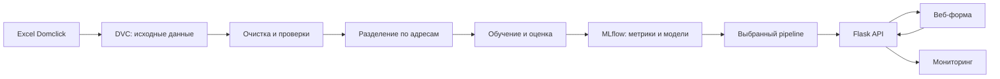

# Дизайн-документ: сервис оценки стоимости квартир в Москве

**Статус:** проект решения; реализация по этапам.

**Автор адаптации:** Давид Погосян (`davidfake4747-jpg`).

**Основа:** учебный проект и шаблон Лабинцева А.И. (`labintsev/mlops`).

**Дата:** 2026-11-14.

**Ветка:** `design-doc`.

**Репозиторий:** https://github.com/davidfake4747-jpg/mlops.

## 1. Задача и границы

Пользователь вводит площадь, количество комнат, этаж квартиры и этажность дома.
Сервис возвращает ориентировочную цену предложения в рублях для сравнения
с объявлениями из обучающей выборки. Целевая переменная — цена объявления,
а не подтверждённая цена сделки.

Учебная цель — реализовать воспроизводимый цикл MLOps: версионирование данных,
подготовку признаков, обучение и оценку модели, API, трекинг экспериментов,
мониторинг и автоматические проверки.

В первую версию входят табличная регрессия по четырём входным признакам,
веб-форма и REST API. Адрес используется для разделения выборки по домам,
но не подаётся модели. Работаем с предоставленным архивом Domclick.
Дополнительный сбор объявлений отложен.

Высокая точность, оценка объектов вне Москвы, обработка изображений,
промышленная нагрузка и высокая отказоустойчивость не входят в первую версию.
Результаты на маленькой выборке не подтверждают качество на всём рынке Москвы.

Чат Haystack + Ollama — отдельный завершающий этап курса. Предлагаемый сценарий:
ответы по документации проекта с указанием источников. Его нужно сверить
с заданием семинара.

## 2. Текущее состояние

| Компонент | Уже есть | Требуется |
| --- | --- | --- |
| Данные | `data.dvc`, предоставленный архив | Импорт и доступное DVC-хранилище |
| Подготовка | Извлечение признаков из Excel, удаление дублей по ID | Адрес, валидация, отчёт качества и воспроизводимый запуск |
| Модели | Константа 10 млн рублей; `lin_reg` — заглушка | Baseline по медиане train и обученная регрессия |
| Инференс | Flask, форма, Bearer-токен, выбор модели | Общая схема признаков и проверка запросов/артефакта |
| Эксперименты | Нет | MLflow с метриками, параметрами и моделями |
| Эксплуатация | Логи Flask | Тесты, GitHub Actions, мониторинг |
| Чат | Нет | Haystack + Ollama |

Далее описано целевое решение. Описанные функции ещё предстоит реализовать.

## 3. Данные

### 3.1. Источник и первичная проверка

Архив: `data-20261114T110354Z-1-001.zip`, выгрузки Domclick.
Дата получения и проверки — 14 ноября 2026 года. Точная дата наблюдения
объявлений не подтверждена: время изменения файлов не заменяет дату сбора.

SHA-256 архива:
`1b9535c1457b5a64151ace8374be3e4f9d2e7f7f6fc3f2d8e88a45738b943cb4`.

| Показатель | Значение |
| --- | --- |
| Excel-файлы | 21 |
| Строки объявлений | 440 |
| Уникальные ID | 80 |
| Повторные строки по ID | 360 |
| ID с различиями в извлечённых признаках или цене | 0 |
| Пропуски в четырёх признаках и цене после удаления дублей | 0 |
| Разные строки адресов до нормализации | 47 |
| Площадь | 20,8–165 м² |
| Цена предложения | 10,3–59,5 млн рублей |
| Медиана всей выборки, только для описания данных | 18,9 млн рублей |

Цены, извлечённые текущим парсером, совпали с отдельной колонкой стоимости.
Проверки полноты и диапазонов не подтверждают корректность каждого значения.

### 3.2. Схема подготовленной таблицы

| Поле | Тип и единица | Назначение |
| --- | --- | --- |
| `id` | Строка | ID объявления, ключ удаления дублей |
| `area` | Число, м² | Вход модели |
| `rooms` | Целое; 0 — студия | Вход модели |
| `floor` | Целое | Вход модели |
| `total_floors` | Целое | Вход модели |
| `price` | Положительное число, рубли | Целевая переменная |
| `address` | Строка | Разделение по домам |
| `source_file` | Строка | Происхождение записи |

Контакты, фотографии и тексты объявлений в обучающую таблицу не переносятся.
Цена за квадратный метр не используется как вход: она вычислена из целевой цены.

### 3.3. Подготовка и контроль качества

1. Сохранить исходные Excel-файлы без изменений под DVC.
2. Читать файлы в фиксированном порядке. Предпочитать отдельные поля выгрузки
   поиску по всему описанию; сохранять ID, адрес и имя исходного файла.
3. Нормализовать пробелы и регистр в адресах, сохраняя дом, корпус и строение.
   Одинаковая этажность сама по себе не определяет один дом.
4. Проверить ID и адрес, конечность чисел, `area > 0`, `price > 0`,
   целые `rooms >= 0`, `floor >= 1`, `total_floors >= 1`, `floor <= total_floors`.
   Исключения сохранять в отчёте с причиной, без скрытого заполнения пропусков.
5. Удалить дубли по ID до split. Конфликтующие ID исключать до разбора причины.
6. Сохранить очищенный CSV и отчёт: строки, дубли, конфликты, исключения,
   уникальные объекты и группы адресов, диапазоны признаков.

Текущие `rooms_1`, `rooms_2`, `rooms_3` не различают студии и квартиры
с четырьмя и пятью комнатами. Для первой обучаемой модели используем числовой
`rooms` вместе с `area`, `floor`, `total_floors`. Схема обучения и API общая.
Старые артефакты с семью признаками не совместимы с этой новой схемой.

## 4. Обучение и оценка

### 4.1. Разделение без утечки

После очистки выполнить `GroupShuffleSplit(test_size=0.2, random_state=42)`
с группами по нормализованным адресам. В holdout попадёт около 20% групп,
доля строк может отличаться. ID и адреса между частями не пересекаются.
Принадлежность ID к частям сохраняется для воспроизводимости.

На train использовать `GroupKFold(n_splits=5)`. Если после очистки осталось
меньше пяти train-групп, остановиться с понятной ошибкой. Преобразования
обучать внутри каждого fold. Holdout не используется для подбора параметров
или признаков; он нужен для финальной проверки выбранного кандидата.

### 4.2. Модели и критерии

- Baseline: `DummyRegressor(strategy="median")`, медиана только обучающей
  части каждого fold. Финальный baseline обучается на всей train-части.
  Описательная медиана 18,9 млн по всем данным здесь не используется.
- Кандидат: pipeline `StandardScaler` + `LinearRegression` по четырём
  числовым признакам. Pipeline сохраняется целиком с именами и порядком полей.
- Основная метрика: MAE в рублях. Дополнительная: MAPE, в отчёте в процентах.
  Перед расчётом MAPE проверяется положительность целевой цены.

Сравнивать модели на одинаковых разбиениях. Сохранять среднее и стандартное
отклонение метрик по folds, метрики holdout и размеры выборок.
Кандидат допускается к использованию при меньшей MAE кросс-валидации
и holdout относительно baseline. Иначе сохраняем baseline и результат сравнения.
Неположительные или неконечные прогнозы кандидата — причина не допускать его
к использованию, а не скрывать проблему обрезкой значений.
На 80 объектах небольшое улучшение не доказывает устойчивого преимущества.

### 4.3. MLflow

Для эксперимента сохранять имя модели, параметры, схему признаков, seed,
настройки split, версии Python и зависимостей, SHA коммита, наличие
незакоммиченных изменений, DVC-хэш данных и размеры частей выборки.
Логировать метрики обеих моделей, результаты folds, pipeline, предсказания
и отчёт качества данных. Начать с локального MLflow.
Новый эксперимент не заменяет модель API автоматически: выбор артефакта явный.

## 5. Архитектура и API

### 5.1. Поток данных



DVC управляет версиями данных и воспроизводимыми стадиями. MLflow сохраняет
эксперименты и артефакты. Flask один раз загружает выбранную модель при старте,
затем выполняет инференс без переобучения. Пути должны работать на macOS и Linux.

### 5.2. Контракт API

Сохранить `GET /` для формы и `POST /api/numbers` для предсказания.
Добавить `GET /health`: 200, когда модель загружена и сервис готов.
Для предсказания нужен `Authorization: Bearer <APP_TOKEN>`.

Пример JSON-запроса с `Content-Type: application/json`:

```json
{"area": 45.5, "rooms": 2, "floor": 5, "total_floors": 12}
```

Схема успешного ответа, без выдуманного прогноза:

```text
{"status": "success", "data": <положительная целая цена в рублях>}
```

Применять ограничения раздела 3.3. Отклонять пустые поля, булевы значения,
дробные комнаты/этажи, NaN и бесконечности. Числовые строки из существующей
формы допускаются после строгой проверки и преобразования.

| HTTP-статус | Ситуация |
| --- | --- |
| 200 | Успешное предсказание |
| 400 | Неверный JSON, пропущенные поля или некорректные значения |
| 401 | Отсутствующий или неверный токен |
| 415 | Неподдерживаемый Content-Type |
| 503 | Модель недоступна или вернула недопустимый прогноз |

Ошибки возвращать как JSON с `status: "error"` и понятным полем `data`.
Внутренние исключения оставлять в логах.

### 5.3. Конфигурация

Приоритет: переменные окружения ОС, затем локальный `.env`, затем несекретные
значения по умолчанию. В Git хранить `.env.example`; исключить `.env`, окружение
Python и локальные артефакты. Токены не записывать в логи.
Модель выбирается через `--model` или `MODEL_NAME`; схема проверяется при старте.
Загружать только собственные доверенные артефакты joblib. В контейнере
не использовать debug-режим.

## 6. Воспроизводимость, CI/CD и мониторинг

### 6.1. DVC и зависимости

Заменить Windows-путь автора на наше хранилище. Для начала допустим локальный
каталог вне репозитория с машинной настройкой в `.dvc/config.local`.
Для другого компьютера и полного CI-прогона потребуется общее доступное
хранилище. Секреты доступа в Git не сохраняются.

Существующий `data.dvc` описывает другой набор из четырёх файлов. При импорте
архива его метаданные обновляются явно. Стадии подготовки и обучения описать
в `dvc.yaml`, параметры — в `params.yaml`. Зафиксировать зависимости, добавить
движок чтения `.xlsx` и инструкции окружения для macOS/Linux.
Критерий воспроизводимости: одинаковые данные, код, параметры и окружение
дают одинаковые составы выборок и метрики в пределах численной погрешности.

### 6.2. GitHub Actions

Для PR и push в `main` запускать установку зависимостей, проверку стиля и тесты:

- извлечение признаков, удаление дублей, отсутствие пересечения адресов;
- общая схема обучения/API, сохранение и загрузка модели;
- API: успешный запрос, неверный токен, пропущенные поля, неверные типы,
  недопустимые диапазоны и невалидный JSON.

Базовые тесты используют небольшие искусственные данные и не зависят от сайтов
или DVC-хранилища. Полное обучение проверяется отдельно при доступности данных.
Сборку Docker-образа добавить на этапе CI/CD. Требование автодеплоя уточнить.

### 6.3. Мониторинг

Предлагаемый локальный вариант: Prometheus и Grafana. Выбор сверить с семинаром.
Показывать число запросов, доли 4xx/5xx, доступность и p95 времени ответа.

Для дрифта сохранять числовые признаки запросов без токенов и адресов.
Сравнивать распределения площади и комнат с train, явно показывая размер
и окно наблюдений. Пороги определить после накопления данных; изменение
среднего само по себе не считать доказанным дрифтом. Без фактических цен
невозможно измерять MAE работающего сервиса.

## 7. Риски и компромиссы

| Риск | Как учитываем |
| --- | --- |
| 80 уникальных объектов | Простой baseline, размеры выборок и разброс метрик в отчётах |
| Дубли и квартиры одного дома | Удаление повторов до split, группировка по адресу |
| Нет подтверждённых цен сделок и даты наблюдения | Оценка относится к ценам предложений из предоставленной выборки |
| Местоположение и состояние не входят в модель | Не обещаем точную оценку всего рынка Москвы |
| Разные написания адресов | Нормализация и ручная проверка спорных групп |
| Изменение формата выгрузок | Проверки схемы и отчёт о нераспознанных строках |
| Возможны разные типы недвижимости | Проверить апартаменты и другие типы до обучения |
| Несовместимость модели и API | Общая схема и проверка артефакта при запуске |
| Недоступность данных на другой машине | Документированное DVC-хранилище и версии зависимостей |

## 8. Этапы и критерии завершения

Работаем в `davidfake4747-jpg/mlops`: `origin` — наш репозиторий,
`upstream` — источник обновлений преподавателя. Каждой теме соответствует
отдельная ветка и PR в наш `main`. После слияния ветки сохраняем по README курса.

| Этап / предлагаемая ветка | Проверяемый результат |
| --- | --- |
| 1. `design-doc` | Заполнены задача, данные, архитектура, API, метрики и риски; планы отделены от готовой реализации |
| 2. `data-ops` | Импорт под DVC, инструкция доступа, воспроизводимая обработка, проверка качества и split |
| 3. `mlflow` | Обучение и сравнение baseline/регрессии, логирование версий, выбранная модель в API |
| 4. `monitoring-ci` | Проверки в GitHub Actions, запуск по инструкции, дашборд технических метрик |
| 5. `haystack-ollama` | Согласованный сценарий чата, инструкция запуска и проверка ответов |

У преподавателя уточнить: нужен ли облачный деплой или достаточно локального
Docker Compose, какой состав мониторинга обязателен и какие сценарии нужны чату.
До уточнения эти решения считаются предложениями, а не требованиями курса.
